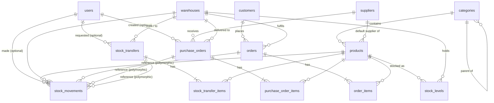

# StockPulse database

MySQL 8. Every table is created by a Laravel migration in
[`backend/database/migrations`](../backend/database/migrations). Rebuild everything with demo data:

```bash
docker compose exec php php artisan migrate:fresh --seed
```

## Entity-relationship diagram



How to read the crow's-foot notation: `||--o{` means "one to zero-or-many", `||--|{` means "one to one-or-many"
(an order always has at least one line).

## Tables

| Table | One row is… | Notes |
|---|---|---|
| `users` | A person who can sign in | `role` = admin / manager / staff, `is_demo` marks the public demo accounts |
| `categories` | A product category | `parent_id` allows nesting |
| `suppliers` | A company we buy from | `lead_time_days` drives reorder points |
| `warehouses` | A stock location | `code` like `MNL-01` is unique |
| `products` | One SKU | Soft-deleted, so history stays intact. Money is `DECIMAL(10,2)` |
| `stock_levels` | Quantity of one product in one warehouse | Unique per (product, warehouse). `quantity` is `UNSIGNED` |
| `stock_movements` | One change in stock | **Append-only ledger.** Signed `quantity_change`, `quantity_after`, polymorphic `reference` |
| `stock_transfers` / `_items` | Moving stock between warehouses | Writes `transfer_out` + `transfer_in` movements |
| `purchase_orders` / `_items` | Buying stock from a supplier | `quantity_received` allows partial deliveries |
| `customers` | A (simulated) buyer | |
| `orders` / `order_items` | A sale | Items copy `unit_price` and `unit_cost` at the time of sale |

## The inventory rule

For every product and warehouse:

```
stock_levels.quantity  ==  SUM(stock_movements.quantity_change)
```

`stock_levels` is a fast cache of the ledger. It's what you query for "how many do we have right now".
The ledger is what you query for "why" and "when". Both are written in the same database transaction,
and `DatabaseSeederTest::test_stock_levels_match_the_ledger` checks the rule holds.

Check it by hand at any time:

```sql
SELECT COUNT(*) AS mismatches
FROM stock_levels sl
LEFT JOIN (SELECT product_id, warehouse_id, SUM(quantity_change) AS total
           FROM stock_movements GROUP BY product_id, warehouse_id) m
  ON m.product_id = sl.product_id AND m.warehouse_id = sl.warehouse_id
WHERE COALESCE(m.total, 0) <> sl.quantity;
```

## Delete behaviour

| Foreign key | On delete | Why |
|---|---|---|
| `products.category_id` | restrict | Can't delete a category that still has products |
| `stock_levels`, `stock_movements`, `*_items` → `products` | restrict | History must never lose its product. Products are soft-deleted instead |
| `*_items` → their header (order, PO, transfer) | cascade | Lines can't exist without their header |
| `*.user_id`, `created_by` | set null | Deleting a user keeps their records, just without a name |
| `categories.parent_id`, `products.default_supplier_id` | set null | Optional links |

## Indexes (beyond primary and foreign keys)

| Index | Serves |
|---|---|
| `stock_movements (product_id, warehouse_id, created_at)` | Movement history on the product page |
| `stock_movements (type, created_at)` | "Sales in the last 30 days" analytics |
| `orders (placed_at)`, `(status, placed_at)`, `(warehouse_id, placed_at)` | Dashboard and order lists |
| `stock_levels (warehouse_id, quantity)` | Low-stock lists per warehouse |
| `products (name)` | Search by name |

## Stock status

Not stored: computed from `quantity` and `reorder_point` (`App\Enums\StockStatus`):

| Status | Rule |
|---|---|
| Out | quantity = 0 |
| Critical | quantity ≤ reorder_point ÷ 3 |
| Low | quantity ≤ reorder_point |
| OK | otherwise |
